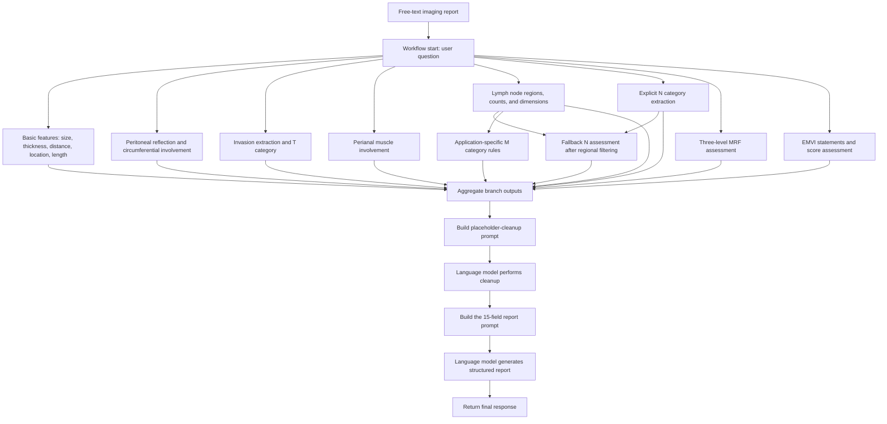

# Rectal Cancer Claude: Detailed Workflow Route

This document describes the nodes, prompts, variable references, and connections visible in the project editor. The page displayed “Unpublished” at inspection. This is a technical description of the current configuration, not evidence of successful execution or clinical validation. No debugging run, save, or publication was performed.

## 1. Purpose and overall route

**Overall route: free-text report → extraction across multiple branches → unit and category normalization → fallback interpretation for missing information → T/N/M, MRF, and EMVI processing → result assembly → placeholder cleanup → template-based generation → final response.**

The diagram groups nodes by function. It describes the information-processing route; it does not establish that every branch executes concurrently. Conditional exits are detailed below.

## 2. Current configuration and processing pattern

| Item | Observed configuration |
|---|---|
| Canvas nodes | 117, including one system configuration node; 116 remaining workflow nodes |
| Node types | 63 text assembly, 35 AI dialogue, 16 conditional routers, one start, one response, and one system configuration node |
| Connections | 157 |
| Direct outgoing connections from start | 14 |
| Configured AI model | All 35 AI nodes display `claude-3-7-sonnet-20250219` |
| Chat history | All 35 AI nodes are configured to use zero history messages |
| Main input | The original report is carried in the start node's “User question” output |
| Missing information | Usually “Unknown”; some category branches use `Nx`, `N+`, or `Mx` |

Most tasks use the following pattern: **a text node builds a task-specific prompt → an AI node performs extraction or interpretation → a conditional router selects an exit → text nodes supply fixed labels or assemble results.**

Text assembly nodes construct strings. Unit conversion, counting, classification, and inference are primarily performed by AI nodes. The canvas contains no code execution nodes for these operations.

All node names, field labels, and quoted conditions below are translated into English. Node IDs in Section 11 preserve the link to the original editor configuration. Translated condition strings explain the existing rules; they are not replacement values to paste into the application. “[Text → AI]” denotes a prompt-building node followed by its AI node.

## 3. Basic tumor features

### 3.1 Tumor size and thickness

**Route:** `Workflow Start → Tumor Size/Thickness Prompt [Text] → Tumor Size/Thickness Extraction [AI] → Aggregate Output`

1. Extract tumor size and thickness from the original report.
2. Represent size using the two dimensions requested by the prompt, separately from craniocaudal length.
3. Distinguish tumor thickness from invasion depth.
4. Convert measurements to centimeters: `a cm × b cm` for size and `x cm` for thickness.
5. Evaluate the fields separately for missing information. If a required size dimension is missing, record size as unknown.

### 3.2 Distance to the anal verge and tumor level

**Main route:** `Workflow Start → Anal Verge Distance [Text] → Anal Verge Distance Output [AI] → Text Assembly 2 → Tumor Level Assessment [AI] → Conditional Router 2`

- Extract the distance to the anal verge, normalize it to centimeters, and also send it directly to the aggregate output.
- The current location prompt maps 0–5 cm to lower, 5–10 cm to middle, and >10 cm to upper.
- If the location result does not contain “Unknown”, pass it through “Initial Tumor Level Result” to the aggregate.
- If it contains “Unknown”, “Fallback Tumor Level Assessment [Text → AI]” returns to the original report and uses anatomical segment descriptions.
- The fallback mapping is: upper rectum → upper; middle-upper or middle rectum → middle; middle-lower or lower rectum → lower; no description → unknown.

The current distance intervals overlap at exactly 5 cm. A later rule revision should specify which interval includes that boundary.

### 3.3 Longitudinal tumor extent

**Route:** `Workflow Start → Longitudinal Tumor Extent [Text → AI] → Aggregate Output`

Extract longitudinal extent, including descriptions such as craniocaudal dimension, and normalize it to centimeters. Return unknown when no explicit length is supplied.

## 4. Peritoneal reflection and circumferential involvement

### 4.1 Relationship to the peritoneal reflection

**Route:** `Workflow Start → Peritoneal Reflection [Text → AI]`

The current prompt evaluates involvement before anatomical position:

| Report description | Application output |
|---|---|
| Involvement, invasion, indistinct interface, poor visualization, thickening, or close relationship | Involved; takes priority over positional descriptions |
| Above the reflection | Above |
| Below the reflection | Below |
| Crossing it or involving positions above and below | Spanning above and below |
| Not described | Unknown |

The result goes directly to the aggregate and also enters “Peritoneal Reflection Router”. A result containing “Involved” becomes visceral peritoneum/peritoneal reflection involved; one containing “Unknown” becomes unknown; other results become not involved. These exits merge through “Peritoneal Reflection Summary for T Assessment” into the invasion summary used for fallback T assessment.

### 4.2 Circumferential extent: three successive routes

**Level 1: an explicit fraction or proportion.**

`Workflow Start → Circumferential Involvement Extraction [Text → AI] → Conditional Router 6`

If the result is known, “Circumferential Proportion Binning [Text → AI]” maps the maximum reported proportion to `<1/4`, `1/4–<1/2`, `1/2–<3/4`, or `3/4–1`, then sends it to the aggregate.

**Level 2: named bowel-wall portions.**

If Level 1 is unknown, “Wall-Based Circumferential Proportion [Text → AI]” uses explicit wall descriptions. The current application encodes one portion as 1/5, two portions as 2/5, three or more as 3/5, and complete circumferential involvement or circumferential thickening as 4/5. Compound descriptions such as left-posterior wall count as two portions. Where several levels are described, use the more extensive level.

If a result is obtained, “Wall-Based Proportion Binning [Text → AI]” maps it to the same four intervals. These fractions are application-defined encoding rules.

**Level 3: clock-face positions.**

If the wall-based result remains unknown, execute:

`Clock-Face Routing Assessment [Text] → Clock-Face Assessment [AI] → Clock-Face Prompt 2 [Text] → Clock-Face Assessment 2 [AI] → Clock-Face Prompt 3 [Text] → Clock-Face Assessment 3 [AI] → Aggregate Output`

Extract `X1–X2 o'clock`, calculate the clockwise span, and apply the current mapping: ≤3 hours → `<1/4`; >3 to ≤6 hours → `1/4–<1/2`; >6 to ≤9 hours → `1/2–<3/4`; >9 hours → `3/4–1`. If no relevant description is present, retain unknown. The exact 3-, 6-, and 9-hour boundaries conflict with the mathematical interval labels; see Section 12.

## 5. Invasion and T category

### 5.1 Extract invaded structures

The original report enters two separate text-and-AI branches:

| Branch | Extracted information |
|---|---|
| Invasion Assessment 1 | Submucosa; muscular invasion and penetration; surrounding fat spaces; mesorectum and invasion depth |
| Invasion Assessment 2 | Serosa; adjacent structures or organs |

The second branch defines adjacent structures as the uterus, cervix, vagina, prostate, seminal vesicles, external sphincter, and levator ani. Its prompt excludes the internal sphincter from this definition. This is a description of the application rule.

The two outputs merge with the peritoneal-reflection involvement summary to create “Invasion Summary”, which also enters the aggregate. Structures without explicit descriptions are to be labeled unknown.

### 5.2 Extract an explicit T category before using fallback inference

**Direct route:** `Workflow Start → T Category Extraction [Text → AI] → Conditional Router`

If a specific T category is written in the report, “Explicit T Category Result” forwards it to the aggregate. If the result contains “Unknown”, use:

`Invasion Summary → Fallback T Assessment [Text → AI] → Fallback T Assessment 2 [Text → AI] → T3 Router`

The fallback first maps structures to categories and then selects the highest category:

| Current application criterion | Assigned label |
|---|---|
| Submucosal invasion | T1 |
| Muscular invasion without penetration | T2 |
| Muscular penetration, serosal involvement, or invasion of perirectal fat spaces | T3 |
| Peritoneal reflection or peritoneal involvement | T4a |
| Adjacent organ involvement | T4b |
| All structures unknown | Unknown |
| No invaded structure according to the prompt | T0 |

These are the application's internal mappings. They have not been validated here as clinical staging criteria.

### 5.3 Subdivide fallback T3 results

If the fallback result contains T3, “T3 Subcategory Assessment [Text → AI]” reads mesorectal invasion depth from the invasion summary:

| Depth | Output |
|---|---|
| ≤1 mm | T3a |
| >1 to ≤5 mm | T3b |
| >5 to ≤15 mm | T3c |
| >15 mm | T3d |
| Unknown | T3 |

The prompt explicitly distinguishes invasion depth from distance to the mesorectal fascia. Non-T3 fallback results pass through “Fallback T Assessment 2 Result” to the aggregate. Explicit T categories extracted directly from the original report use a separate exit and do not pass through this fallback T3 subdivision route.

## 6. Perianal muscle involvement

**Route:** `Workflow Start → Perianal Muscle Assessment [Text → AI] → Perianal Muscle Junction Router`

1. Assess descriptions involving the anal canal, internal and external sphincters, levator ani, and rectal–levator junction; return involved, no involvement, or unknown.
2. Forward a known result directly to the aggregate.
3. If unknown, “Perianal Muscle Junction Assessment 2 [Text → AI]” extracts the distance between the lesion and the levator ani.
4. A second router assigns unknown if the result contains “Unknown”; involved if the complete result exactly equals `Lesion-to-levator ani distance: 0mm` or `Lesion-to-levator ani distance: 0cm`; otherwise, no involvement.

The current condition uses exact string matching rather than numeric comparison. Variants such as `0 mm` or `0.0cm` require execution testing.

## 7. Lymph node extraction and N category

### 7.1 Extract regions, counts, and dimensions

**Route:** `Workflow Start → Lymph Node Regions and Counts [Text → AI]`

Extract the node count and long-axis, short-axis, or unspecified-axis dimensions for each region. Normalize dimensions to millimeters. Combine regions described together; use separate lines for separately described regions. Preserve suspicious-positive nodes and nodes of unspecified location. Do not count numeric annotations in parentheses after region names.

The current prompt treats every mentioned lymph node, including a small lymph node, as positive or involved. Downstream N and M results therefore depend on this application assumption.

### 7.2 Direct N category extraction

`Workflow Start → N Category Extraction [Text → AI] → Direct N Category Router [Router]`

- If the report explicitly states an N category, forward it through “Explicit N Category Result” to the aggregate.
- If the report states no abnormal lymph nodes, the prompt returns N0.
- If the result contains “Unknown”, continue to regional filtering and fallback interpretation.

### 7.3 Filter regions and select a fallback route

`Lymph node summary → Lymph Node Filtering for N Assessment [Text → AI] → N Assessment Route Selector`

The filtering node removes content about external iliac and inguinal nodes and retains other node information. The router selects the following exits in order:

| Condition | Route |
|---|---|
| Contains “Suspicious-Positive Lymph Nodes” | Suspicious-Positive Node Count Assessment [Text → AI] → aggregate |
| Otherwise contains “No Involved Lymph Nodes” | Fixed N0 output → aggregate |
| Otherwise | N Assessment Short-Axis Evaluation [Text → AI] → Lymph Node Short-Axis Router [Router] |

The suspicious-positive count route and the size-qualified count route use:

| Count | Application N label |
|---|---|
| 0 | N0 |
| 1 | N1a |
| 2–3 | N1b |
| 4–6 | N2a |
| ≥7 | N2b |
| Involved or suspicious-positive nodes present, count unknown | N+, subject to route-specific conditions |

### 7.4 Short-axis route for other nodes

- Maximum short axis ≥5 mm: the AI returns a marker translated here as “Exceeds 5mm”; the router continues to “Short-Axis-Qualified N Count Prompt [Text] → Short-Axis-Qualified N Count Assessment [AI]” for count-based categorization. The marker's wording says “exceeds”, but the configured threshold includes exactly 5 mm.
- Maximum short axis <5 mm: “Lymph Node Short Axis Below Threshold” supplies N0.
- Short axis unknown: “Unknown Lymph Node Short Axis” supplies Nx.
- In the count route, an unknown regional count with a known total below seven, or no known count, leads to N+. If region and count are not established, the prompt calls for Nx. A known count of at least seven can support the application's N2b output even if additional counts are unknown.

The extraction prompt requires an explicitly identified lymph node short axis. It does not automatically treat a soft-tissue signal focus or an unspecified dimension as a lymph node short axis.

## 8. Application-specific M category route

**Route:** `Lymph node summary → M Category Assessment [Text → AI] → M Category Router → fixed M1/M0/Mx text → M Category Summary → Aggregate Output`

The M prompt consumes the lymph node summary and focuses on external iliac and inguinal regions:

| Router match | Output |
|---|---|
| Contains “Greater than or equal to 4.9mm” (≥4.9 mm) | M1 |
| Otherwise contains “Less than 4.9mm” (<4.9 mm), “Lymph nodes explicitly absent”, or “Not mentioned” | M0 |
| Otherwise | Mx |

The current prompts do not assess other distant metastatic sites such as the liver, lungs, or bone, and the canvas has no dedicated node for directly extracting an explicitly reported M category. This is therefore an application-specific M rule, rather than a complete distant-metastasis assessment. In particular, its “not mentioned → M0” output should not be interpreted from this document as comprehensive exclusion of distant metastasis.

## 9. MRF and EMVI

### 9.1 MRF: explicit label, then distance, then fascial description

1. `Explicit MRF Status Extraction [Text → AI] → Explicit MRF Status Router 1`: recognize positive or negative MRF/CRM notation. If identified, supply a fixed positive or negative label to the aggregate.
2. Otherwise, `MRF Distance Assessment [Text → AI] → MRF Distance Assessment [Router]`: distance from the lesion to the mesorectal fascia ≤0.1 cm (1 mm) → positive; >0.1 cm → negative.
3. If still unknown, `Mesorectal Fascia Description Assessment [Text → AI] → MRF Router 9`: explicit fascial thickening or an indistinct fascial boundary → positive; explicit noninvolvement or the relevant negative descriptions → negative; otherwise unknown.
4. All exits supply fixed text to the aggregate.

The prompts instruct the model not to infer involvement from enlarged nodes alone or from a generally blurred tissue space. The explicit-label prompt uses both MRF and CRM notation; that reflects the present configuration.

### 9.2 EMVI: direct statements before score-based fallback

**Designed route:** `EMVI Status Assessment [Text → AI] → EMVI Status Assessment [Router]`

- A result without “Unknown” should pass through “Direct EMVI Status Result” to the aggregate.
- Otherwise, “EMVI Score Assessment [Text → AI]” uses score >2 → positive; score ≤2 → negative; no reported score → unknown. Its prompt also recognizes explicit positive/negative statements and signs.

**Observed limitation:** the router's input displays a placeholder translated as “Select a reference variable”, with no input selected. Its condition is “does not contain Unknown”. Correct execution of this route cannot be established from the present configuration.

## 10. Assembly, cleanup, and final response

**Final node chain (translated labels):**

`Aggregate Output → Remove Irrelevant Content → Simplify Content → Text Assembly 29 → AI Dialogue 21 → Final Response`

1. **Aggregate Output — aggregate:** concatenate branch results in template order, including slots for mutually exclusive exits.
2. **Remove Irrelevant Content — cleanup prompt:** construct instructions to remove unresolved `{{number}}` placeholders.
3. **Simplify Content — AI cleanup:** execute the cleanup instructions. This is model-based rather than deterministic regex or code cleanup.
4. **Text Assembly 29 — report prompt:** embed the cleaned content in the final 15-field template.
5. **AI Dialogue 21 — report generation:** generate the structured text and use unknown for missing fields.
6. **Final Response — response:** return that AI response to the user.

The final report has these top-level fields:

| No. | Report field |
|---|---|
| 1 | Tumor size |
| 2 | Tumor thickness |
| 3 | Distance from the tumor to the anal verge |
| 4 | Tumor location |
| 5 | Longitudinal tumor extent |
| 6 | Relationship to the peritoneal reflection |
| 7 | Circumferential extent of involvement |
| 8 | Extent of tumor invasion |
| 9 | Perianal muscle involvement |
| 10 | Involved lymph nodes |
| 11 | T category |
| 12 | N category |
| 13 | M category |
| 14 | Mesorectal fascia status (MRF) |
| 15 | Extramural venous invasion status (EMVI) |

Field 8 expands into submucosa, muscular layer, surrounding fat spaces, mesorectum and invasion depth, serosa, adjacent structures or organs, and visceral peritoneum/peritoneal reflection. The application's current report template is Chinese. This English workflow document does not mean that English report output is configured in the application.

## 11. Reusable project description

This project implements a large-language-model workflow for structuring free-text rectal cancer imaging reports. Separate branches extract tumor size, thickness, distance to the anal verge, location, longitudinal extent, relationship to the peritoneal reflection, circumferential involvement, invasion extent, perianal muscle involvement, and lymph node characteristics. When direct extraction is insufficient, successive fallback routes use bowel-wall descriptions, clock-face positions, invaded structures, and lymph node counts or short-axis dimensions. Application-defined rules organize T, N, and M categories and MRF and EMVI status. The branch outputs are assembled, cleaned of unresolved placeholders, and transformed into a structured report with 15 top-level fields. The classification rules described here reflect the current application configuration; their accuracy and scope require independent validation.
